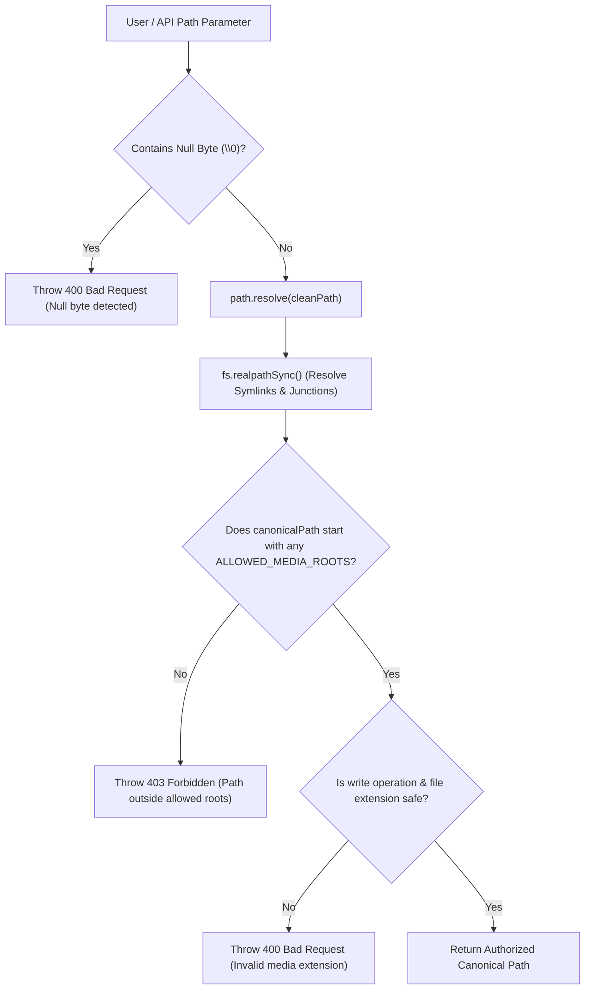
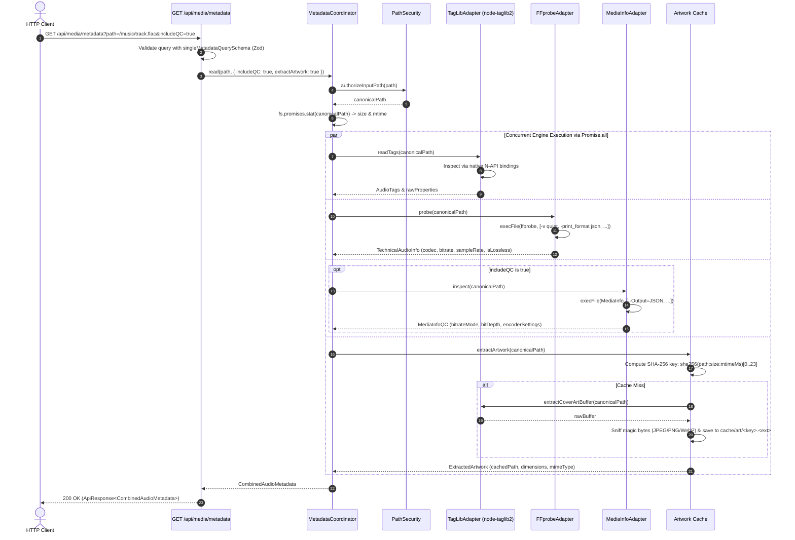
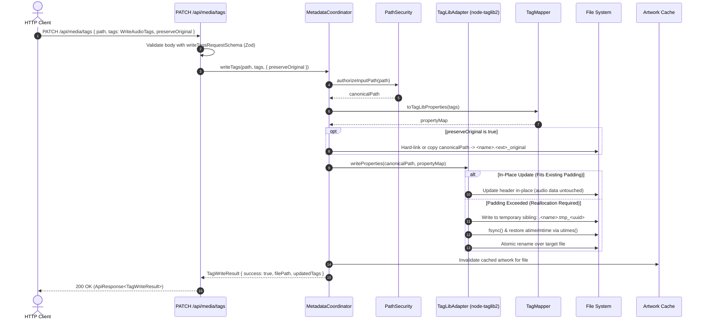
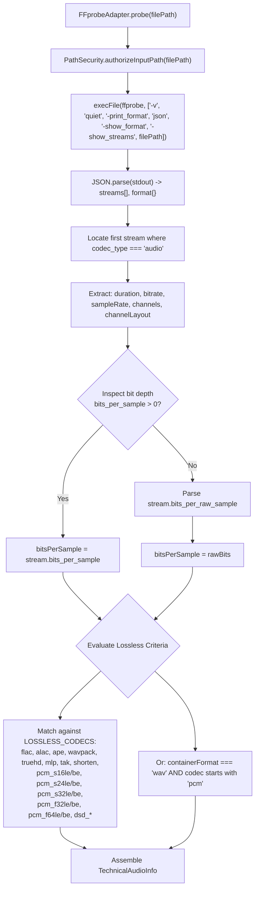
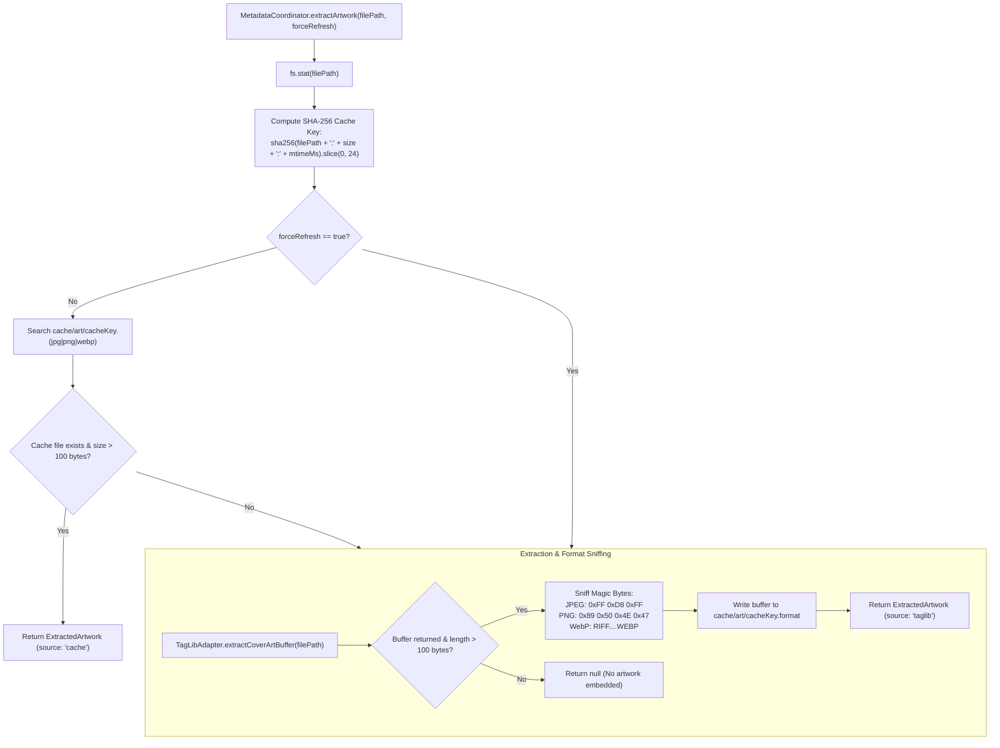
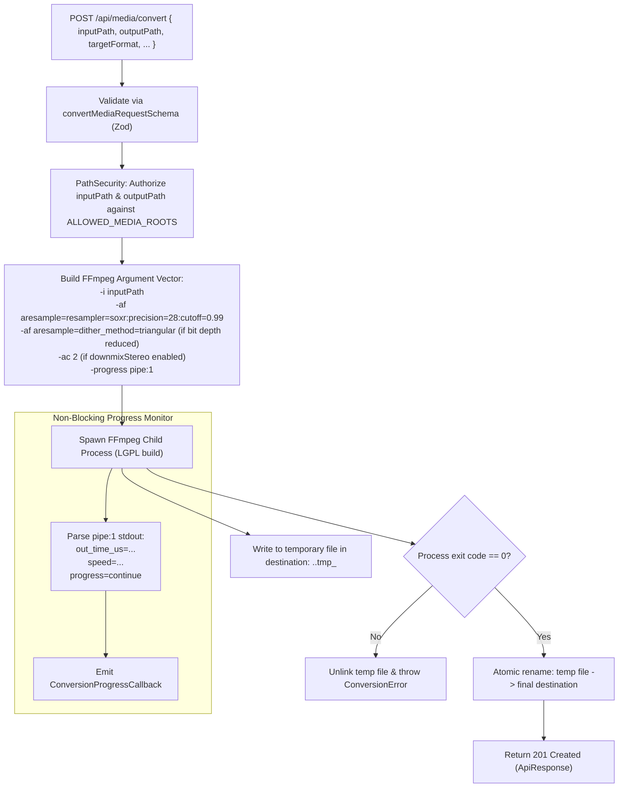
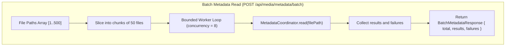

# My Music

A modern, high-performance web audio library and music metadata manager built with Next.js 16 (App Router), TypeScript, TagLib 2.x, FFprobe, MediaInfo, FFmpeg, Ark UI, and Tailwind CSS v4.

---

## Source Directory Structure & Layer Responsibilities

The codebase follows a strict separation of concerns under `src/`, enforcing clear boundaries between client and server code, business domains, shared UI, and technical infrastructure:

```
src/
├── app/                      # ROUTING & COMPOSITION ONLY
│   ├── (routes)/             # Page routes, layouts, templates, loading, error boundaries
│   ├── api/                  # Thin Route Handlers (HTTP method dispatch, schema parsing)
│   ├── layout.tsx            # Root application layout
│   └── globals.css           # Global Tailwind CSS styles and theme tokens
│
├── features/                 # BUSINESS DOMAINS (One directory per domain)
│   ├── media/                # Audio metadata, tagging, transcoding, and artwork domain
│   │   ├── schemas/          # Route input validation schemas (isomorphic Zod)
│   │   ├── index.ts          # Client-safe public API (schemas, types, constants)
│   │   └── server.ts         # Server-only public API ("server-only" entry points)
│   └── scanner/              # Audio library scanning and discovery domain
│       ├── components/       # UI components owned by the scanner (ScanModal, Dashboard)
│       ├── hooks/            # Client state hooks (useScanModalStore)
│       ├── schemas/          # Validation schemas (scanRequestSchema)
│       └── index.ts          # Client-safe feature public API
│
├── components/               # SHARED UI WITH NO BUSINESS KNOWLEDGE
│   ├── ui/                   # Generic primitives (Button, Input, Slider, Modal)
│   ├── common/               # App-wide compounds (PageHeader, EmptyState, ConfirmDialog)
│   ├── layout/               # Shell layout elements (Header, Sidebar, Navigation)
│   └── providers/            # Context providers (Theme, QueryClient, Toast)
│
├── hooks/                    # SHARED CLIENT HOOKS (Generic, domain-agnostic)
│
├── lib/                      # GENERIC ISOMORPHIC UTILITIES & PRIMITIVES
│   ├── cn.ts                 # Classname merge utility (clsx + tailwind-merge)
│   ├── format.ts             # String formatting, time/duration display, date parsers
│   ├── number.ts             # Numeric clamps, rounding, and byte calculations
│   ├── schema/               # Generic primitive Zod schemas (text, number, boolean)
│   └── media/                # Shared isomorphic media contracts:
│       ├── formats.ts        # Audio extensions, codecs, MIME mapping, lossless checks
│       ├── path.schema.ts    # Reusable file and directory path validation schemas
│       ├── tag-registry.ts   # Audio tag specification, field dictionary, property maps
│       └── tags.schema.ts    # AudioTags and WriteAudioTags schemas
│
├── server/                   # SHARED SERVER INFRASTRUCTURE (server-only)
│   ├── api/                  # Standardized response helpers (apiSuccess, handleRouteError)
│   └── media/                # Media subsystem execution engines:
│       ├── adapters/         # Low-level binary & binding adapters (TagLib, FFprobe, MediaInfo)
│       ├── media-converter.ts# Transcoding engine with SoX DSP resampling and dithering
│       ├── media-diagnostics.ts # Deep binary inspection & health diagnostics
│       ├── metadata-coordinator.ts # High-level TagLib/FFprobe/MediaInfo orchestrator
│       ├── path-security.ts  # Directory confinement & symlink traversal protection
│       ├── tool-inspector.ts # Binary version and LGPL license validator
│       └── types.ts          # Server-only technical types and data models
│
├── config/                   # APPLICATION CONFIGURATION
│   ├── env.server.ts         # Validated server-only environment variables (serverEnv)
│   └── routes.ts             # Application route constants
│
└── types/                    # CROSS-CUTTING, DOMAIN-INDEPENDENT TYPES
    └── api.ts                # Standardized ApiResponse<T> envelope and error models
```

### Layer Boundary & Dependency Matrix

| Layer                | Runtime Boundary                                              | May Import                                                                                                  | Must Not Import                                           |
| :------------------- | :------------------------------------------------------------ | :---------------------------------------------------------------------------------------------------------- | :-------------------------------------------------------- |
| **`src/app`**        | Server & Client (Pages / Leaf Components)                     | `features` (public API), `components`, `hooks`, `lib`, `server`, `config`, `types`                          | _(Root level)_                                            |
| **`src/features`**   | Isolated Domain (Client-Safe `index.ts` / Server `server.ts`) | Own internals, other `features` (via public API), `components`, `hooks`, `lib`, `server`, `config`, `types` | `app`                                                     |
| **`src/components`** | Client & Server (Leaf UI)                                     | `hooks`, `lib`, `config` (client-safe), `types`                                                             | `app`, `features`, `server`                               |
| **`src/hooks`**      | Client-Only                                                   | `lib`, `config` (client-safe), `types`                                                                      | `app`, `features`, `components`, `server`                 |
| **`src/server`**     | Server-Only (`import 'server-only'`)                          | `lib`, `config`, `types`                                                                                    | `app`, `features`, `components`, `hooks`                  |
| **`src/lib`**        | Isomorphic (Client & Server Safe)                             | `config` (client-safe), `types`                                                                             | `app`, `features`, `components`, `hooks`, `server`        |
| **`src/config`**     | Config Boundary (`env.server` vs `env.client`)                | `types`                                                                                                     | `app`, `features`, `components`, `hooks`, `server`, `lib` |
| **`src/types`**      | Pure Type Declarations (Zero JS output)                       | _(Nothing)_                                                                                                 | All application layers                                    |

---

## Media Subsystem Architecture & Decoupled Engines

The media subsystem operates on three decoupled engines backed by native binaries with automatic WebAssembly/subprocess fallbacks:

```mermaid
flowchart TD
    subgraph ClientLayer["Client & Consumer Layer"]
        UI["Web UI / Ark UI Components"]
        API_Client["Bruno / External HTTP Clients"]
    end

    subgraph RouteLayer["Presentation & Routing (src/app/api/media)"]
        R_Health["/api/health & /api/health/media\n(GET)"]
        R_Meta["/api/media/metadata\n(GET / POST batch)"]
        R_Tech["/api/media/technical\n(GET)"]
        R_Tags["/api/media/tags\n(GET / PATCH / POST batch)"]
        R_Convert["/api/media/convert\n(POST)"]
        R_Art["/api/media/artwork\n(GET stream / POST)"]
        R_Scan["/api/scan\n(POST)"]
    end

    subgraph FeatureLayer["Business Domain Boundary (src/features/media)"]
        ZodSchemas["Route Schemas & Public API\n- tags.schema, metadata.schema\n- conversion.schema, artwork.schema\n- index.ts (client-safe) & server.ts (server-only)"]
    end

    subgraph ServerLayer["Shared Server Infrastructure (src/server/media) - server-only"]
        Coordinator["MetadataCoordinator\n- TagLib + FFprobe + MediaInfo orchestration\n- Non-destructive artwork extraction & disk caching"]
        Converter["MediaConverter (FFmpeg LGPL)\n- SoX 28-bit resampler & dither\n- ITU-R BS.775 stereo downmix\n- Atomic rename transcode"]
        Adapters["Engine Adapters\n- TagLibAdapter (node-taglib2 native & worker sidecar)\n- FFprobeAdapter (elementary stream prober)\n- MediaInfoAdapter (QC inspection)\n- TagMapper (ID3/Vorbis/MP4 property mapping)"]
        Security["Path Security\n- ALLOWED_MEDIA_ROOTS confinement\n- Symlink realpath resolution & traversal protection"]
    end

    subgraph LibLayer["Shared Isomorphic Primitives (src/lib/media)"]
        LibPrimitives["Isomorphic Primitives & Specs\n- formats.ts (codecs, MIME types, isLosslessAudio)\n- path.schema.ts (filePathSchema)\n- tag-registry.ts (TAG_FIELDS, property mappings)\n- tags.schema.ts (audioTagsSchema, writeAudioTagsSchema)"]
    end

    subgraph ExternalLayer["OS & Native Binaries"]
        TagLibBin["TagLib 2.x (node-taglib2 / sidecar worker)"]
        FFprobeBin["FFprobe CLI"]
        MediaInfoBin["MediaInfo CLI"]
        FFmpegBin["FFmpeg CLI (LGPL)"]
        DiskCache["Disk Cache (cache/art/*.jpg|png|webp)"]
        AudioFiles["Audio Filesystem (FLAC, MP3, ALAC, Opus, AAC, WAV, OGG)"]
    end

    UI --> RouteLayer
    API_Client --> RouteLayer

    RouteLayer --> FeatureLayer
    FeatureLayer --> ServerLayer
    FeatureLayer --> LibLayer
    ServerLayer --> LibLayer

    ServerLayer --> ExternalLayer
```



---

### Detailed Component Roles & Responsibilities

| Component                 | Location                                         | Primary Responsibilities & Design Patterns                                                                                                                                                                                                          |
| :------------------------ | :----------------------------------------------- | :-------------------------------------------------------------------------------------------------------------------------------------------------------------------------------------------------------------------------------------------------- |
| **`MetadataCoordinator`** | `src/server/media/metadata-coordinator.ts`       | **Multi-Engine Orchestrator**: Executes TagLib, FFprobe, and MediaInfo concurrently via `Promise.all`. Normalizes tags into unified `AudioTags`. Manages disk artwork caching (`cache/art`), in-flight deduplication, and zero-remuxing extraction. |
| **`TagLibAdapter`**       | `src/server/media/adapters/taglib.adapter.ts`    | **Native Metadata Engine**: Primary interface using `NodeTagLib2Adapter` (native C++ N-API bindings via `voltraco/node-taglib2`), with automatic fallback to standalone `taglib-worker` executable. Guarantees bit-for-bit lossless tag writes.     |
| **`TagMapper`**           | `src/server/media/adapters/tag-mapper.ts`        | **Property Transformation Engine**: Maps heterogeneous raw TagLib property dictionaries (ID3v2.3, ID3v2.4, Vorbis Comments, MP4 atoms, APEv2) to/from strongly-typed `AudioTags` and handles custom tag definitions.                                |
| **`FFprobeAdapter`**      | `src/server/media/adapters/ffprobe.adapter.ts`   | **Stream Specification Engine**: Spawns `ffprobe` with JSON output formatting to inspect container and codec details. Evaluates streams against a mathematical lossless matrix with bounded concurrency (`MAX_CONCURRENCY = 8`).                    |
| **`MediaInfoAdapter`**    | `src/server/media/adapters/mediainfo.adapter.ts` | **QC Quality Inspector**: Supplements FFprobe with deep analysis: exact CBR/VBR bitrate mode, bit depth, encoder library strings, and gapless audio playback parameters.                                                                            |
| **`MediaConverter`**      | `src/server/media/media-converter.ts`            | **Audiophile Transcoding Engine**: Spawns LGPL-compliant FFmpeg with SoX 28-bit precision resampling, triangular/lipshitz dithering, ITU-R BS.775 stereo downmixing, progress tracking via pipe, and atomic rename writes.                          |
| **`PathSecurity`**        | `src/server/media/path-security.ts`              | **Filesystem Security Guard**: Validates all incoming and outgoing file paths against `ALLOWED_MEDIA_ROOTS`. Resolves symlinks using `fs.realpath` and prevents path traversal attacks.                                                             |
| **`ToolInspector`**       | `src/server/media/tool-inspector.ts`             | **Runtime Health & Compliance**: Inspects installed binaries, verifies versions, checks LGPL licensing flags (`--enable-gpl` / `--enable-nonfree` exclusion), and tests engine capabilities.                                                        |

---

## Audio Tag Registry & Field Specification

The application enforces a single source of truth for audio metadata fields defined in `src/lib/media/tag-registry.ts`. TagLib's property map automatically translates these canonical fields across underlying container formats:

| Domain Field          | Canonical Property      | Recognized Aliases             | Value Kind          | Validation / Type                                                |
| :-------------------- | :---------------------- | :----------------------------- | :------------------ | :--------------------------------------------------------------- |
| `title`               | `TITLE`                 | _(None)_                       | `text`              | Cleaned non-empty string                                         |
| `artists`             | `ARTIST`                | `ARTISTS`, `ARTISTNAME`        | `list`              | String array (split on `[,;/]`)                                  |
| `album`               | `ALBUM`                 | _(None)_                       | `text`              | String                                                           |
| `albumArtists`        | `ALBUMARTIST`           | `ALBUM ARTIST`, `ALBUMARTISTS` | `list`              | String array                                                     |
| `composers`           | `COMPOSER`              | _(None)_                       | `list`              | String array                                                     |
| `genres`              | `GENRE`                 | `GENRES`                       | `list`              | Normalized string array                                          |
| `year`                | `YEAR`                  | _(Special Date Parsing)_       | `positiveInteger`   | 4-digit safe integer (e.g. `2024`)                               |
| `date`                | `DATE`                  | _(Special Date Parsing)_       | `text`              | ISO-8601 string (`YYYY-MM-DD`)                                   |
| `trackNumber`         | `TRACKNUMBER`           | `TRACK`                        | `positiveInteger`   | 1-indexed track position                                         |
| `trackTotal`          | `TRACKTOTAL`            | `TOTALTRACKS`, `TRACKCOUNT`    | `positiveInteger`   | Total tracks on disc                                             |
| `discNumber`          | `DISCNUMBER`            | `DISKNUMBER`, `DISC`, `DISK`   | `positiveInteger`   | 1-indexed disc position                                          |
| `discTotal`           | `DISCTOTAL`             | `TOTALDISCS`, `DISCCOUNT`      | `positiveInteger`   | Total discs in album                                             |
| `bpm`                 | `BPM`                   | `TEMPO`                        | `positiveNumber`    | Beats per minute (e.g. `128.5`)                                  |
| `isrc`                | `ISRC`                  | _(None)_                       | `text`              | Strict 12-char ISRC regex (`/^[A-Z]{2}[A-Z0-9]{3}\d{7}$/`)       |
| `upc`                 | `UPC`                   | `UPCA`, `UPCE`, `GTIN`         | `text`              | 8, 12, 13, or 14-digit numeric string                            |
| `barcode`             | `BARCODE`               | _(None)_                       | `text`              | Barcode identifier string                                        |
| `catalogNumber`       | `CATALOGNUMBER`         | `CATALOG NUMBER`, `CATALOGNO`  | `text`              | Catalog number                                                   |
| `label`               | `LABEL`                 | `PUBLISHER`, `RECORDLABEL`     | `text`              | Record label / publisher                                         |
| `lyrics`              | `LYRICS`                | `UNSYNCEDLYRICS`               | `freeText`          | Multiline lyrics content                                         |
| `comment`             | `COMMENT`               | `DESCRIPTION`                  | `freeText`          | Arbitrary user notes                                             |
| `copyright`           | `COPYRIGHT`             | _(None)_                       | `freeText`          | Copyright notice                                                 |
| `compilation`         | `COMPILATION`           | _(None)_                       | `text`              | Boolean indicator (`true`/`false`)                               |
| `rating`              | `RATING`                | _(None)_                       | `nonNegativeNumber` | Popularimeter / user rating                                      |
| `replayGainTrackGain` | `REPLAYGAIN_TRACK_GAIN` | _(None)_                       | `gain`              | Decibel gain (parsed from `"-6.2 dB"`)                           |
| `replayGainTrackPeak` | `REPLAYGAIN_TRACK_PEAK` | _(None)_                       | `nonNegativeNumber` | Track peak amplitude ratio                                       |
| `replayGainAlbumGain` | `REPLAYGAIN_ALBUM_GAIN` | _(None)_                       | `gain`              | Album decibel gain                                               |
| `replayGainAlbumPeak` | `REPLAYGAIN_ALBUM_PEAK` | _(None)_                       | `nonNegativeNumber` | Album peak amplitude ratio                                       |
| `customTags`          | _(Dynamic Key)_         | _(Arbitrary ASCII)_            | `record`            | User key-value pairs (`boolean \| number \| string \| string[]`) |

### Custom Tag Sanitization Rules

- **Name Constraints**: Custom keys must start with a letter (`[A-Za-z]`), contain only printable ASCII characters, and cannot contain the `=` sign.
- **Reserved Words**: Keys matching JavaScript prototypes (`constructor`, `prototype`, `__proto__`) are strictly rejected.
- **TagLib Properties Exclusion**: Standard known properties cannot be set via `customTags` to avoid property duplication.

---

## Audio Format & Codec Capabilities Matrix

The media engine provides broad format support derived from the intersection of TagLib 2.x, FFprobe, and FFmpeg:

| Extension        | Container Format | Native Tag Standard                | Inspection & Probing |     Lossless Codec?      | Transcode Target? |
| :--------------- | :--------------- | :--------------------------------- | :------------------: | :----------------------: | :---------------: |
| `.flac`          | FLAC             | Vorbis Comments + Picture Blocks   |      Supported       |       Yes (`flac`)       |     Supported     |
| `.m4a` / `.mp4`  | MPEG-4 Part 14   | MP4 Atoms (`covr`, `©nam`, `trkn`) |      Supported       |    Optional (`alac`)     |     Supported     |
| `.mp3`           | MPEG Audio       | ID3v2.4 / ID3v2.3 (`APIC`, `TIT2`) |      Supported       |        No (`mp3`)        |     Supported     |
| `.opus`          | Ogg / Opus       | Vorbis Comments                    |      Supported       |       No (`opus`)        |     Supported     |
| `.ogg`           | Ogg Vorbis       | Vorbis Comments                    |      Supported       |      No (`vorbis`)       |     Supported     |
| `.wav`           | RIFF WAVE        | RIFF INFO / ID3 Chunk              |      Supported       | Yes (`pcm_s*`, `pcm_f*`) |     Supported     |
| `.aiff` / `.aif` | AIFF             | AIFF Chunk / ID3                   |      Supported       |      Yes (`pcm_s*`)      |     Supported     |
| `.wv`            | WavPack          | APEv2 / WavPack Tags               |      Supported       |     Yes (`wavpack`)      |     Supported     |
| `.ape`           | Monkey's Audio   | APEv2 Tags                         |      Supported       |       Yes (`ape`)        | No (Decode only)  |
| `.mpc`           | Musepack         | APEv2 Tags                         |      Supported       |     No (`musepack`)      | No (Decode only)  |
| `.wma`           | ASF              | Windows Media Tags                 |      Supported       |       No (`wmav2`)       | No (Decode only)  |
| `.dsf` / `.dff`  | DSD              | ID3v2 (DSF)                        |      Supported       |      Yes (`dsd_*`)       | No (Decode only)  |

---

## Audiophile DSP & Transcoding Engine Specification

`MediaConverter` provides studio-grade DSP processing powered by FFmpeg with SoX resampling, anti-aliasing filtering, and dithering:

### 1. High-Precision SoX Resampler

When changing sample rates (e.g. 96 kHz / 48 kHz to 44.1 kHz CD audio), the engine applies the **SoX (Sound eXchange) resampler filter**:

```bash
-af "aresample=resampler=soxr:precision=28:cutoff=0.99"
```

- **Precision (28 bits)**: Provides 168 dB of signal-to-noise dynamic range, well beyond the 144 dB theoretical limit of 24-bit audio.
- **Passband Cutoff (0.99)**: Preserves 99% of the passband frequency spectrum (e.g., flat up to 21.8 kHz on a 44.1 kHz master) while guaranteeing rejection of imaging frequencies above Nyquist.

### 2. Triangular & Noise-Shaped Dithering

When reducing bit depth (e.g. from 24-bit or 32-bit floating point down to 16-bit integer PCM):

- **Triangular Dithering (`aresample=dither_method=triangular`)**: Generates high-pass triangular probability density function (TPDF) noise, completely eliminating quantization distortion and correlation errors without altering frequency balance.
- **Lipshitz Noise-Shaping (`aresample=dither_method=lipshitz`)**: Psychoacoustically curves quantization noise into higher, less sensitive auditory bands (14 kHz - 20 kHz), lowering perceived noise in the critical 1 kHz - 5 kHz range.

### 3. Multichannel to Stereo Downmixing

When downmixing 5.1 or 7.1 surround streams to stereo (`downmixStereo: true`), coefficients strictly follow the **ITU-R BS.775** standard:
$$L = L_f + 0.7071 \cdot C + 0.7071 \cdot L_s$$
$$R = R_f + 0.7071 \cdot C + 0.7071 \cdot R_s$$
This guarantees dialog centeredness ($C$), surround ambiance preservation ($L_s, R_s$), and prevents clipping without dynamic range compression.

---

## Filesystem Security & Confinement Architecture

All filesystem interactions are guarded by `PathSecurity` (`src/server/media/path-security.ts`), enforcing strict boundary protection:



- **Symlink Resolution**: Uses native `realpath` to prevent directory traversal escapes via symlinked folders pointing outside the library root.
- **Argument Array Execution**: Subprocesses are spawned using `execFile` with argument arrays, preventing OS command injection vulnerabilities.

---

## Media Subsystem Execution Flows

### 1. Unified Metadata Read Flow

The metadata read flow orchestrates `TagLib`, `FFprobe`, and optional `MediaInfo` concurrently to assemble a rich `CombinedAudioMetadata` object without redundant disk reads:



---

### 2. Crash-Safe Tag Writing Flow

When modifying audio tags (`PATCH /api/media/tags` or `POST /api/media/tags/batch`), operations pass through strict validation and crash-safe filesystem guarantees:



---

### 3. Technical Audio Inspection & Mathematical Lossless Verification

`FFprobeAdapter` extracts stream specifications and mathematically validates codec integrity against the lossless registry:



---

### 4. Zero-Remuxing Artwork Extraction & Caching

Embedded album artwork is extracted directly via TagLib without container remuxing, validated using zero-dependency magic byte sniffing, and cached deterministically:



---

### 5. Audiophile Media Transcoding Pipeline

`MediaConverter` executes audiophile-grade conversions with SoX 28-bit precision resampling, dithering, and real-time progress parsing:



---

### 6. High-Throughput Batch Processing Flows

For bulk operations, concurrent workloads are bounded to prevent CPU and I/O starvation:



---

### 7. Failure Recovery, Resilience & Lifecycle Matrix

| Failure Mode                           | Detection Point                    | Recovery & Mitigation Strategy                                                                    | Resulting Client Response                                            |
| :------------------------------------- | :--------------------------------- | :------------------------------------------------------------------------------------------------ | :------------------------------------------------------------------- |
| **File Not Found**                     | `PathSecurity` (`fs.existsSync`)   | Short-circuits immediately before spawning any child process or allocating buffers.               | `404 Not Found` (`NotFoundError`)                                    |
| **Path Traversal Escape**              | `PathSecurity.authorizeInputPath`  | Resolves canonical `realpath` and tests membership within `ALLOWED_MEDIA_ROOTS`.                  | `403 Forbidden` (`ForbiddenError`)                                   |
| **Corrupted Audio Header**             | `TagLib` / `FFprobe` parser        | Process returns non-zero error. Caught in coordinator; logs error and isolates failure.           | In single: `500 Internal Error`; In batch: recorded in `failures[]`. |
| **Padding Exceeded on Write**          | `TagLibAdapter`                    | Automatically writes to temporary sibling file (`.<name>.tmp_<uuid>`) and performs atomic rename. | `200 OK` (Tag write succeeds seamlessly).                            |
| **Conversion Process Crash / Timeout** | `MediaConverter`                   | Monitors exit signals, removes any incomplete temporary output file, and rejects execution.       | `500 Internal Error` (`ConversionError`).                            |
| **LGPL Non-Compliance**                | `ToolInspector`                    | Checks `ffmpeg -version` for `--enable-gpl` or `--enable-nonfree` flags.                          | Warning logged; reported via `/api/health/media`.                    |
| **Missing Artwork**                    | `MetadataCoordinator`              | Fails gracefully if no embedded cover art picture blocks exist.                                   | `404 Not Found` on artwork API; `artwork: null` on metadata read.    |
| **Process Termination / Shutdown**     | `process.on('SIGINT' / 'SIGTERM')` | Kills active FFmpeg child processes (`q` → `SIGTERM` → `SIGKILL`) to prevent orphaned tasks.      | Clean OS process exit.                                               |

---

## Standardized API Error Code Catalog

The application translates domain exceptions, Zod validation issues, and engine errors into a predictable JSON error structure via `handleRouteError`:

| HTTP Status | Error Code              | Description / Trigger Scenario                                           | Frontend Recommendation                   |
| :---------: | :---------------------- | :----------------------------------------------------------------------- | :---------------------------------------- |
|   **400**   | `BAD_REQUEST`           | Malformed JSON syntax or invalid file extension                          | Display user-facing notification          |
|   **401**   | `UNAUTHORIZED`          | Missing authentication credentials or invalid session token              | Redirect to login                         |
|   **403**   | `FORBIDDEN`             | Target file path lies outside `ALLOWED_MEDIA_ROOTS`                      | Alert user that file is outside library   |
|   **404**   | `NOT_FOUND`             | File does not exist on disk or has no embedded artwork                   | Render empty artwork fallback placeholder |
|   **409**   | `CONFLICT`              | Concurrent write collision or duplicate resource identifier              | Prompt user to retry operation            |
|   **422**   | `VALIDATION_ERROR`      | Schema validation failure; carries structured `details: ApiFieldError[]` | Highlight invalid form fields             |
|   **429**   | `RATE_LIMITED`          | Request rate limit exceeded                                              | Throttle subsequent requests              |
|   **500**   | `INTERNAL_SERVER_ERROR` | Native binary crash, subprocess failure, or unhandled exception          | Log error identifier for support          |

---

## Prerequisites & Installation

### 1. System Requirements

Ensure the following tools are installed and accessible in your system `PATH` (or configure their absolute paths in `.env`):

- **Node.js**: v20 or newer
- **FFmpeg & FFprobe**: [ffmpeg.org](https://ffmpeg.org/) (LGPL build, e.g. `ffmpeg` and `ffprobe` on `PATH`)
- **MediaInfo CLI**: [mediaarea.net](https://mediaarea.net/) (e.g. `MediaInfo` on `PATH`)
- **TagLib**: Built-in via `node-taglib2` (native N-API bindings) or standalone `taglib-worker` executable

### 2. Install Project Dependencies

```bash
npm install
```

### 3. Environment Configuration

Copy the example environment file:

```bash
cp .env.example .env
```

| Variable              | Default                 | Description                                                    |
| :-------------------- | :---------------------- | :------------------------------------------------------------- |
| `NODE_ENV`            | `development`           | Runtime environment (`development`, `production`, `test`)      |
| `PORT`                | `3000`                  | Port for the Next.js HTTP server                               |
| `ALLOWED_MEDIA_ROOTS` | `e:/Code/Next/my-music` | Semicolon/comma-separated list of allowed absolute directories |
| `FFMPEG_PATH`         | `ffmpeg`                | Path or executable name for FFmpeg CLI                         |
| `FFPROBE_PATH`        | `ffprobe`               | Path or executable name for FFprobe CLI                        |
| `MEDIAINFO_PATH`      | `MediaInfo`             | Path or executable name for MediaInfo CLI                      |
| `TAGLIB_WORKER_PATH`  | _(optional)_            | Path to standalone `taglib-worker` executable fallback         |
| `METADATA_ENGINE`     | `native`                | Engine mode for metadata (`native` \| `wasm`)                  |
| `PROBING_ENGINE`      | `native`                | Engine mode for probing (`native` \| `wasm`)                   |
| `CONVERSION_ENGINE`   | `native`                | Engine mode for audio conversion (`native` \| `wasm`)          |
| `ART_CACHE_DIR`       | `cache/art`             | Directory for caching extracted album artwork                  |

---

## API Reference

All JSON endpoints return a standardized `ApiResponse<T>` envelope:

```ts
// Success Response
{
  "success": true,
  "data": T,
  "message": "Optional human-readable confirmation",
  "meta": { "timestamp": "ISO-8601" }
}

// Error Response
{
  "success": false,
  "error": {
    "code": "VALIDATION_ERROR" | "NOT_FOUND" | "BAD_REQUEST" | "FORBIDDEN" | "INTERNAL_SERVER_ERROR",
    "message": "Human-readable description",
    "details": [...] // Structured validation field errors or debug context
  }
}
```

---

### 1. Health & Engine Diagnostics

#### `GET /api/health`

Fast, non-blocking process liveness probe.

- **Example Response (200 OK)**:
    ```json
    {
        "success": true,
        "data": {
            "status": "ok",
            "uptime": 142.5,
            "timestamp": "2026-10-28T02:00:00.000Z"
        }
    }
    ```

#### `GET /api/health/media`

Deep diagnostic check of TagLib, FFprobe, MediaInfo, and FFmpeg binaries, verifying installation paths, versions, engine health, and LGPL licensing compliance.

- **Example Response (200 OK)**:
    ```json
    {
        "success": true,
        "data": {
            "status": "healthy",
            "timestamp": "2026-10-28T02:00:00.000Z",
            "engines": {
                "metadata": {
                    "status": "healthy",
                    "engine": "native",
                    "provider": "node-taglib2 (native N-API)",
                    "version": "2.9.6",
                    "features": { "read": true, "write": true, "artwork": true, "inPlacePadding": true }
                },
                "probing": {
                    "status": "healthy",
                    "ffprobe": { "available": true, "version": "7.1" },
                    "mediaInfo": { "available": true, "version": "24.12" }
                },
                "conversion": {
                    "status": "healthy",
                    "version": "7.1",
                    "isLgplCompliant": true,
                    "hasSoxr": true
                }
            }
        }
    }
    ```

---

### 2. Audio Metadata APIs

#### `GET /api/media/metadata`

Inspects unified metadata for an audio file (merging TagLib tags, FFprobe technical specs, optional MediaInfo QC, and artwork presence).

- **Query Parameters**:
    - `path` (string, required): Allowed absolute path to audio file.
    - `includeQC` (boolean, default: `false`): Include deep MediaInfo QC inspection.
    - `raw` (boolean, default: `false`): Include raw stream payloads.

- **Example Response (200 OK)**:
    ```json
    {
        "success": true,
        "data": {
            "filePath": "E:/Music/Track.flac",
            "fileSizeBytes": 45129384,
            "lastModified": "2026-10-28T01:30:00.000Z",
            "tags": {
                "title": "Song Title",
                "artist": "Artist Name",
                "album": "Album Title",
                "genre": ["Alternative", "Rock"],
                "year": 2024,
                "trackNumber": 1,
                "trackTotal": 12
            },
            "technical": {
                "codec": "flac",
                "codecLongName": "FLAC (Free Lossless Audio Codec)",
                "containerFormat": "flac",
                "duration": 245.8,
                "bitrate": 1411200,
                "sampleRate": 44100,
                "channels": 2,
                "channelLayout": "stereo",
                "bitsPerSample": 24,
                "isLossless": true
            },
            "artwork": {
                "cachedPath": "E:/Code/Next/my-music/cache/art/a1b2c3d4e5f6.jpg",
                "filename": "a1b2c3d4e5f6.jpg",
                "mimeType": "image/jpeg",
                "sizeBytes": 124580
            }
        }
    }
    ```

#### `POST /api/media/metadata/batch`

Extracts metadata concurrently across an array of audio files.

- **Request Body**:
    ```json
    {
        "paths": ["E:/Music/Song1.flac", "E:/Music/Song2.mp3"]
    }
    ```

---

### 3. Audio Tags APIs

#### `GET /api/media/tags`

Reads normalized metadata tags for an audio file.

- **Query Parameters**:
    - `path` (string, required): Allowed absolute path to audio file.

#### `PATCH /api/media/tags`

Partially updates audio metadata tags using TagLib. Setting a tag to `null` deletes it.

- **Request Body**:

    ```json
    {
        "path": "E:/Music/Track.flac",
        "tags": {
            "title": "Updated Song Title",
            "artist": "Artist Name",
            "album": "Album Name",
            "trackNumber": 1,
            "trackTotal": 10,
            "year": 2026,
            "genre": ["Ambient", "Electronic"],
            "comment": null
        },
        "preserveOriginal": false
    }
    ```

- **Example Response (200 OK)**:
    ```json
    {
        "success": true,
        "data": {
            "filePath": "E:/Music/Track.flac",
            "updatedTags": {
                "title": "Updated Song Title",
                "artist": "Artist Name",
                "album": "Album Name",
                "trackNumber": 1,
                "trackTotal": 10,
                "year": 2026,
                "genre": ["Ambient", "Electronic"],
                "comment": null
            },
            "preserveOriginal": false
        },
        "message": "Tags updated successfully"
    }
    ```

#### `POST /api/media/tags/batch`

Batch updates metadata tags across multiple audio files.

- **Request Body**:
    ```json
    {
        "targets": [
            {
                "path": "E:/Music/01.flac",
                "tags": { "artist": "Band Name", "album": "Album Title" }
            },
            {
                "path": "E:/Music/02.flac",
                "tags": { "artist": "Band Name", "album": "Album Title" }
            }
        ],
        "preserveOriginal": false
    }
    ```

---

### 4. Technical Audio Specifications

#### `GET /api/media/technical`

Returns stream codec, container specifications, duration, bitrate, sample rate, channels, channel layout, and lossless evaluation via FFprobe and MediaInfo.

- **Query Parameters**:
    - `path` (string, required): Audio file path.
    - `includeQC` (boolean, default: `false`): Supplement with MediaInfo metrics.

- **Example Response (200 OK)**:
    ```json
    {
        "success": true,
        "data": {
            "codec": "flac",
            "codecLongName": "FLAC (Free Lossless Audio Codec)",
            "containerFormat": "flac",
            "duration": 218.44,
            "bitrate": 984000,
            "sampleRate": 48000,
            "channels": 2,
            "channelLayout": "stereo",
            "bitsPerSample": 24,
            "isLossless": true,
            "streamCount": 1
        }
    }
    ```

---

### 5. Album Artwork APIs

#### `GET /api/media/artwork`

Streams cached album artwork with production caching headers (`Cache-Control: public, max-age=31536000, immutable`).

- **Query Parameters** (one required):
    - `file` (string): Cached artwork filename (e.g. `a1b2c3d4e5f6.jpg`). Path traversal is strictly prevented.
    - `path` (string): Audio file path (extracts and caches on-the-fly).

#### `POST /api/media/artwork`

Extracts artwork from an audio file, stores it into `cache/art`, and returns artwork metadata.

- **Request Body**:
    ```json
    {
        "path": "E:/Music/Album/Song.flac",
        "forceRefresh": false
    }
    ```

---

### 6. Media Conversion & Transcoding

#### `POST /api/media/convert`

Transcodes an audio file with audiophile-grade SoX resampling, dithering, and format conversion.

- **Request Body**:
    ```json
    {
        "inputPath": "E:/Music/Master.wav",
        "outputPath": "E:/Music/Release.mp3",
        "targetFormat": "mp3",
        "bitrate": "320k",
        "sampleRate": 44100,
        "resampler": "soxr",
        "ditherMethod": "triangular",
        "downmixStereo": true
    }
    ```
- **Example Response (201 Created)**:
    ```json
    {
        "success": true,
        "data": {
            "inputPath": "E:/Music/Master.wav",
            "outputPath": "E:/Music/Release.mp3",
            "targetFormat": "mp3",
            "duration": 218.44,
            "outputSizeBytes": 8740200
        },
        "message": "Media converted successfully"
    }
    ```

---

### 7. Library Scanner

#### `POST /api/scan`

Queues a background directory scan for audio files.

- **Request Body**:
    ```json
    {
        "directory": "E:/Music",
        "scanMode": "addNew",
        "recursive": true
    }
    ```
- **Example Response (202 Accepted)**:
    ```json
    {
        "success": true,
        "data": {
            "scanId": "scan_1727625000000_abc123",
            "directory": "E:/Music",
            "scanMode": "addNew",
            "recursive": true,
            "timestamp": "2026-10-28T02:00:00.000Z"
        },
        "message": "Library scan initiated successfully for \"E:/Music\""
    }
    ```

---

## Workflow Integration Examples

### Example 1: Ingesting & Probing an Audio Track via cURL

```bash
curl -X GET "http://localhost:3000/api/media/metadata?path=E:/Music/Artist/Track.flac&includeQC=true" \
  -H "Accept: application/json"
```

### Example 2: Updating Tags Losslessly with cURL

```bash
curl -X PATCH "http://localhost:3000/api/media/tags" \
  -H "Content-Type: application/json" \
  -d '{
    "path": "E:/Music/Artist/Track.flac",
    "tags": {
      "title": "Midnight Odyssey",
      "artists": ["Kavinsky", "Lovefoxxx"],
      "album": "Nightcall EP",
      "year": 2024,
      "genre": ["Synthwave", "Electronic"],
      "customTags": {
        "catalognumber": "REC-0012"
      }
    },
    "preserveOriginal": false
  }'
```

### Example 3: Transcoding Master WAV to 320k MP3 with SoX Resampling

```bash
curl -X POST "http://localhost:3000/api/media/convert" \
  -H "Content-Type: application/json" \
  -d '{
    "inputPath": "E:/Music/Master/Track_96k24b.wav",
    "outputPath": "E:/Music/Release/Track_44k16b.mp3",
    "targetFormat": "mp3",
    "bitrate": "320k",
    "sampleRate": 44100,
    "resampler": "soxr",
    "ditherMethod": "triangular",
    "downmixStereo": true
  }'
```

---

## Bruno API Collection

The repository includes a complete [Bruno](https://www.usebruno.com/) collection under [`bruno/`](file:///e:/Code/Next/my-music/bruno/) containing 29 test requests covering:

- **Health**: Liveness, readiness, and media engine diagnostics
- **Metadata**: Single and batch inspection
- **Tags**: Reading, single PATCH updates, and batch updates
- **Conversion**: FLAC, MP3 with SoX dithering, Opus, and validation failure tests
- **Artwork**: Extraction and binary streaming
- **Technical Info**: Deep stream probing
- **Library Scan**: Background scan queuing

### Running Bruno Tests:

1. Open the **Bruno** desktop app.
2. Select **Open Collection** and choose the `bruno/` directory.
3. Select the `Local` environment (`{{baseUrl}} = http://localhost:3000`).
4. Run individual requests or execute the full test runner.

---

## Development Scripts

```bash
# Start local development server with Turbopack
npm run dev

# Run TypeScript compilation and build production bundle
npm run build

# Run ESLint validation
npm run lint

# Format codebase via Prettier
npm run format
```

---

## License

MIT
